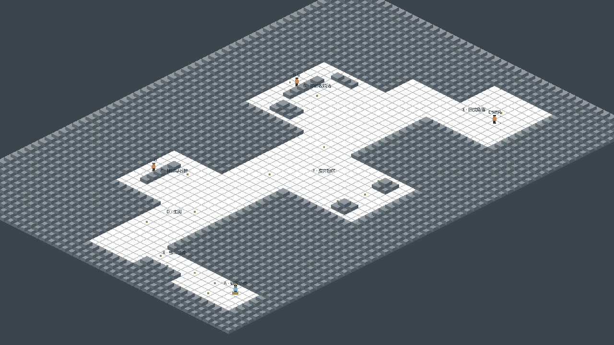
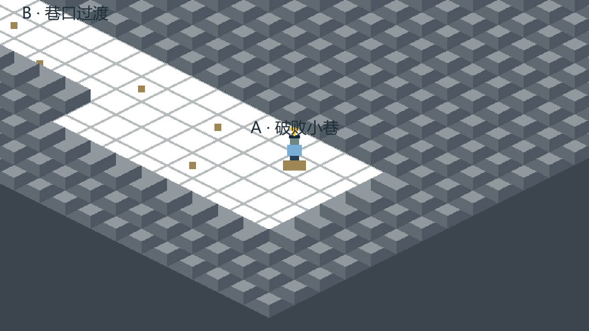
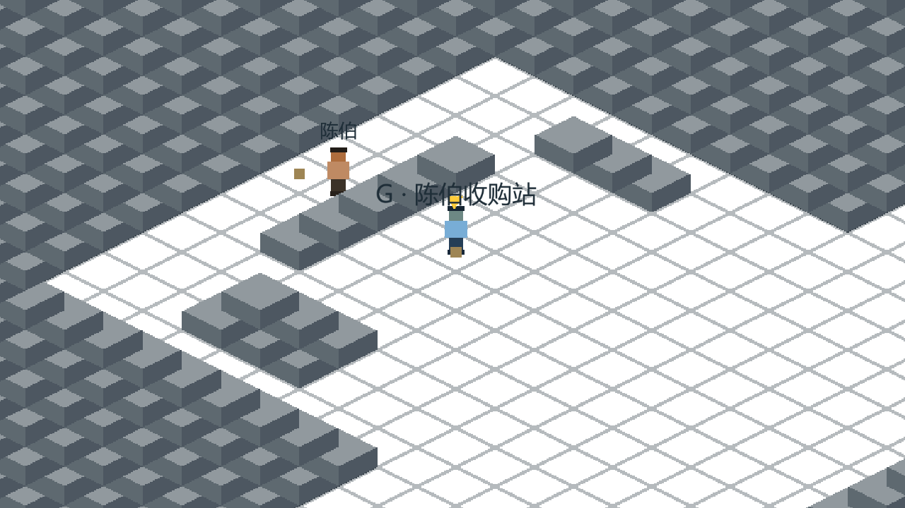

# M1 Unity 灰盒原型：打开、试玩与验收

> M1历史交付说明：PR #3已合并，负责人已确认Windows人工试玩验收通过。以下记录M1原始范围与操作；当前M2新增功能和操作以[M2说明](../m2/README.md)为准。

## 技术决定与范围

项目采用 **Unity 6.3 LTS 6000.3.25f1，修订 e1dba0a9aba4**，C#，Windows PC首发目标。版本来自本机实际可用编辑器，锁定在 [ProjectVersion.txt](../../Unity/ProjectSettings/ProjectVersion.txt)，对应[官方补丁说明](https://unity.com/releases/editor/whats-new/6000.3.25f1)。不使用Godot，不在本轮自动升级其他补丁。

使用Unity 2D内置渲染、Isometric Grid/Tilemap、2D刚体和复合碰撞、按脚底位置排序的Sprite及正交相机。M1直接读取键盘按键，使用内置Input Manager；没有第三方插件、URP/Cinemachine或额外玩法框架。

依据[总规划](../PROJECT_PLAN.md)、[P0规格](../p0/P0_SPEC.md)、[决策记录](../p0/REVIEW_AND_DECISIONS.md)、[P0验收设计](../p0/ACCEPTANCE.md)和[概念图说明](../p0/references/README.md)。本轮M1授权更新了此前M0的编码禁令与技术待定项，故事和P0/P1边界不变。

已实现：键盘八方向移动、黄色箭头朝向、近距离镜头跟随、单张连续七区地图、建筑/墙体/柜台/堆物/NPC的2D碰撞、三名NPC和20个稳定点位占位、区域标识和邻近点说明。

未实现：拾取、搜索产出、背包、负重、交易、食物、帮工、休息、存档、游戏时间、旧货买卖、战斗或状态数值。接近点位只显示占位说明，不触发这些功能。所有几何图形是灰盒占位，不使用或裁切AI参考图。

## 用Unity打开

1. 克隆本PR分支，或在PR合并后更新仓库。Unity Hub中选择添加项目，选仓库内 **`Unity` 文件夹**，不是仓库根目录。
2. 使用精确版本 **6000.3.25f1**。首次导入会生成Library并解析编辑器自带模块，不需要安装第三方插件。
3. 打开 `Assets/Scenes/M1Greybox.unity`。场景、Tile资产、占位Sprite、设置及`.meta`均已入库，无需先执行代码生成。
4. 点击Play，再点击Game视图取得键盘焦点。使用 **WASD或方向键**移动；斜向速度归一化，松键停下。黄色箭头显示朝向。
5. 从A小巷经B到D主街，分别访问C早餐摊、G收购站、F废弃物区和E旧货角落，并原路返回。点位没有任务门，也没有E键交互。

场景Hierarchy中的 `M1 Continuous County Block` 包含实际Grid、Ground、Solid Tilemap、点位和阿生；相机为独立的Main Camera。Scene视图可以直接检查并选中这些对象，不是只在运行时隐式生成地图。

## Windows试玩

在Unity菜单选择 **Reborn 1985 → M1 → Build Windows x64 development player**。该命令先验证场景和物理，再构建 `Unity/Builds/Windows/Reborn1985.exe`。

双击EXE启动，使用WASD/方向键；关闭窗口退出。必须保留同目录的 `Reborn1985_Data`、`MonoBleedingEdge`、`UnityPlayer.dll`等文件，不能只复制EXE。开发构建与ZIP在本机生成，受`.gitignore`排除，不把引擎二进制提交进Git；从GitHub取得源码后可按上述步骤重建。

第一目标为Windows x64，当前实际验证采用Direct3D 11。无需联网玩法或外部服务。手柄、移动端和其他操作方案不属于本轮。

## 可调整原型参数与工程结构

`Assets/Settings/M1Settings.asset`暴露逻辑地图范围、菱形地块世界尺寸、移动速度、脚底碰撞半径、镜头大小/平滑时间、临时角色比例及区域范围/入口。这些是原型测试值，不是最终地图或像素规格。

| 默认测试项 | 值 |
| --- | --- |
| 逻辑范围 | 60×42格 |
| Isometric地块世界尺寸 | 1×0.5 Unity单位 |
| 角色占位图 | 24×40像素，64像素/单位 |
| 移动速度 / 脚底半径 | 2.4单位/秒 / 0.13单位 |
| 正交半高 / 跟随平滑时间 | 3.25单位 / 0.12秒 |

七区原型逻辑范围如下，终点不含最大值。建筑/柜台和点位清单在编辑器生成工具中集中维护；修改布局或尺寸后需重建并重新验证，不根据参考图锁定坐标。

| 区域 | 逻辑矩形 x,y,宽,高 | 可站立入口 x,y |
| --- | --- | --- |
| A 破败小巷 | 3,3,5,9 | 6,5 |
| B 巷口 | 5,12,3,5 | 6,14 |
| D 主街 | 3,17,48,7 | 12,20 |
| C 林婶早餐摊 | 14,24,9,7 | 18,26 |
| G 陈伯收购站 | 35,24,12,9 | 41,28 |
| F 废弃物区 | 25,7,10,10 | 29,15 |
| E 旧货角落 | 46,8,10,9 | 49,13 |

`Assets/Scripts`为移动、镜头、设置、世界/点位、显示和可选开发验证；`Assets/Editor/M1ProjectTools.cs`负责确定性生成、验证与Windows构建；`Assets/Art/Placeholders`仅含简单几何占位图和Tile资产。

编辑器菜单 **Rebuild greybox scene** 按设置重建原型，会重写生成场景及占位资源；先保存/备份手工场景修改。普通打开试玩不需要重建。**Verify scene and physics** 会载入保存的M1场景，运行前应保存当前工作。

## 自动验证与运行截图

[验证记录与限制](VALIDATION.md)区分Unity编译、编辑器物理检查、Windows运行测试和未完成的手工键盘验收。[编辑器检查结果](evidence/edit-mode-checks.txt)与[Windows运行结果](evidence/runtime-result.json)为实际执行输出。

正常启动没有自动行走。仅开发版加 `-m1-smoke -m1Output "输出目录"` 时才启用测试驱动，以同一个Rigidbody2D控制器走七区往返，不传送、不关闭碰撞。测试为加速检查会临时设置三倍模拟速度，结束还原；不作为游戏时间系统。

截图来自Windows运行版摄像机对实际场景的离屏渲染，解决隐藏窗口屏幕回读全黑的问题；包含实际Tilemap、Sprite与场景内文字，不含OnGUI说明面板。总览只在测试截图时临时拉远相机，正常试玩仍为近景跟随。

其他视角：[C早餐摊](screenshots/zone-C.png)、[F废弃物区](screenshots/zone-F.png)、[E旧货角落](screenshots/zone-E.png)。这些是灰盒运行画面，不是最终美术承诺。
