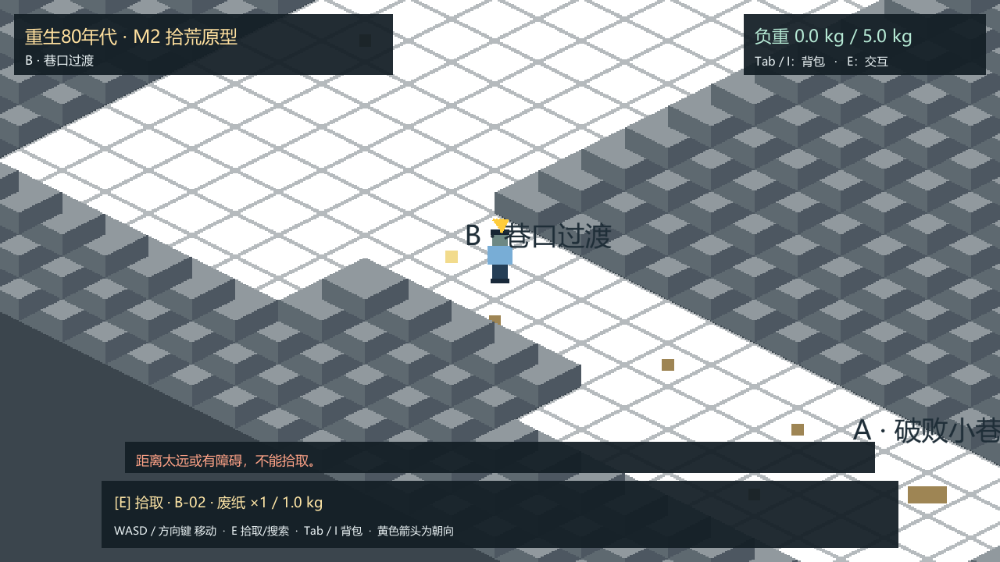
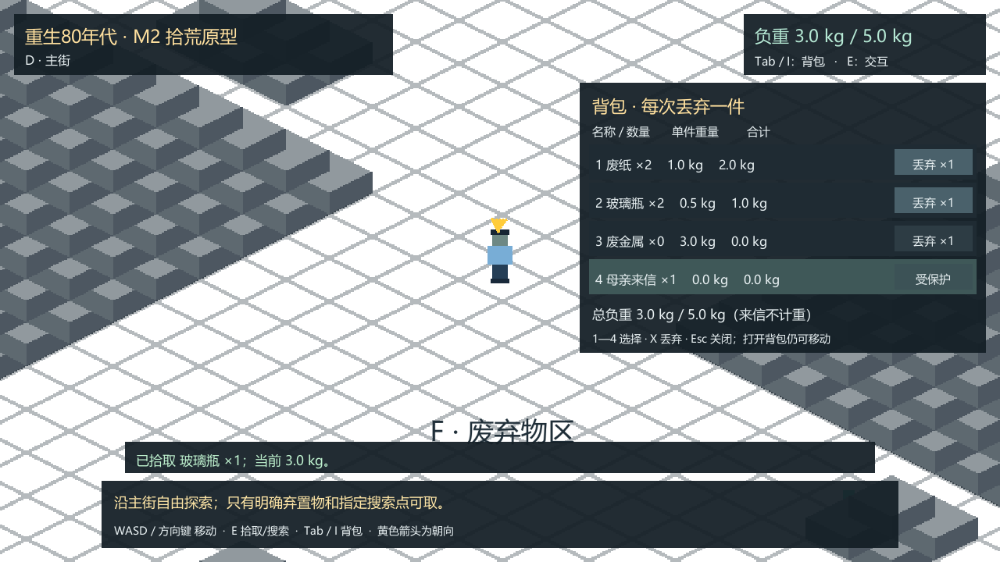
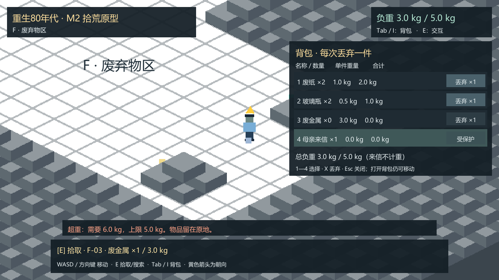

# M2 拾荒、背包与负重试玩说明

> M2历史交付说明：PR #4已合并，负责人于2026-10-19确认审核完成并批准M3。下文保留M2交付时的范围和操作；当前新增交易见[M3说明](../m3/README.md)。

在原有 `Unity/Assets/Scenes/M1Greybox.unity` 上继续实现，没有重新创建工程或地图。锁定Unity **6000.3.25f1（e1dba0a9aba4）**、C#、Windows x64、Mono及原有2D工作流。原Grid、两张Tilemap、20点位ID/坐标、玩家控制器、相机和碰撞保留；七个既有点位追加M2组件并按资源种类着色。

## 打开与运行

Unity Hub添加仓库的 `Unity/` 文件夹，用6000.3.25f1打开；载入 `Assets/Scenes/M1Greybox.unity`，点击Play并让Game视图获得键盘焦点。无需运行地图生成器。界面使用Unity自带的[uGUI 2.0.0](https://docs.unity3d.com/Packages/com.unity.ugui@2.0/manual/index.html)，已锁定在manifest与lock文件中，没有第三方插件、额外引擎或Input System迁移。

Windows玩家构建位于本机 `Unity/Builds/M2-Windows/`，试玩压缩包为 `Unity/Builds/Reborn1985-M2-Windows-x64.zip`。解压到可写目录后双击 `Reborn1985.exe`，保留同目录全部文件；包内附有中文 `试玩说明.txt`。构建目录与ZIP不提交Git，实际构建和包校验见[验证记录](VALIDATION.md)及[构建记录](evidence/build-info.json)。

| 操作 | 键位/方式 |
| --- | --- |
| 移动 | WASD或方向键；与M1相同，斜向归一化 |
| 拾取、搜索 | 靠近后按E；按住只触发一次，松开后可再按 |
| 开关背包 | Tab或I；不暂停或阻止移动与E交互 |
| 关闭背包 | Esc |
| 选择背包物品 | 背包打开时按1废纸、2玻璃瓶、3废金属、4母亲来信 |
| 丢弃一件 | 背包中按X，或点击对应行“丢弃×1” |
| 退出 | 关闭Windows窗口；本版不保存运行状态 |

每一行显示名称、数量、单件重量和该类合计；右上角与背包底部同时显示总负重/上限。来信始终为一封、0kg，按钮不可用，选择后按X也会被状态层拒绝，不提供阅读剧情。

## 可试玩内容与建议路线

从A小巷经B到D主街；黄色标记为废纸，绿色为玻璃瓶，蓝灰色为废金属。靠近合法目标会出现名称、重量与E提示。搜索堆领取后保留灰色标记，提示本次运行已搜索；可见废品领取后原地标记消失。

| 原点位 | 内容 | 单次运行产出 |
| --- | --- | --- |
| B-02、D-01 | 各一份废纸 | 各1件，1.0kg/件 |
| D-02、D-03 | 各一只玻璃瓶 | 各1件，0.5kg/件 |
| F-01 | 废弃竹筐堆搜索 | 额外废纸1份，只成功领取一次 |
| F-02 | 废包装堆搜索 | 额外玻璃瓶1只，只成功领取一次 |
| F-03 | 废金属 | 1件，3.0kg |

基础四件应得到废纸2份、瓶子2只，共3.0kg。此时取F-03需要6.0kg，会拒绝且原物保留；丢弃一份废纸后再取金属，恰好5.0kg。搜索也检查容量；装不下时不会消耗该点的唯一次数。可以放下物品再回来搜索。自行车、NPC私物、旧壶、商品及其他占位点没有拾取功能。

普通物品按一件放在脚边可达地面，可同次运行重拾；落点检查地板、墙体、NPC及直线脚底碰撞通路。无安全落点时拒绝丢弃、背包不扣除。地面物品无阻挡碰撞体，不会堵路；多个丢弃物尽量间隔摆放。重拾仍检查容量。

全部重量与5.0kg容量都为**暂定测试参数**，不是最终平衡或历史结论。配置位于 `Assets/Settings/M2Settings.asset`：整数克数、交互距离默认0.72单位、丢弃候选最远0.8单位。距离/落点是可调整的原型参数；不改变既有地图和相机尺度。

## 数量与后续接入边界

`M2RunState`集中管理背包、已领取来源及地面记录。每份实物从来源领取起保留唯一unitId；丢弃只是转移所有权，重拾再转回背包，原点位/搜索点标志不重置。状态操作同步完成后才更新界面；快速交互不会同时保留两个副本。重量使用整数克，界面转换为公斤显示，无浮点累计。

`M2RunSnapshot`提供脱离实时状态的快照，含schemaVersion、背包物品身份/种类/来源、已领取来源ID及地面物身份/位置。此结构为M4保存、M5跨日清理预留，没有磁盘存读档、游戏时钟、睡觉、日切换或刷新入口。当前**关闭并重开程序即开始新一次运行**；不以开发验证中的Time.timeScale代替游戏时间。

已批准的“当天可重拾、跨日清理”仍是P0规则；M2只实现单次运行前半部分。陈伯出售/现金（M3）、餐食/帮工、读信剧情、休息/存档（M4）、跨日/完整P0回归（M5）均等待后续明确授权。

## 可重复验证与重建

菜单 **Reborn 1985 → M2 → Verify inventory and M1 regression** 执行M1原有物理/连通检查及M2状态检查，输出 `Unity/Logs/M1EditModeValidation.txt` 与 `M2EditModeValidation.txt`。会载入保存的场景，请先保存手工修改。

菜单 **Reborn 1985 → M2 → Build Windows x64 development player** 先验证，再重新载入保存场景并构建 `Builds/M2-Windows/Reborn1985.exe`。批处理对应 `Reborn1985.Editor.M2ProjectTools.Verify` / `BuildWindows`。包必须包含整个构建目录；不要仅压缩EXE。

Windows开发版加 `-m2-smoke -m2Output "绝对输出目录"` 执行真实玩家运行验证：通过同一个刚体控制器走路、通过E按键边沿接口触发拾取、调用同一个背包丢弃处理器，覆盖七项场景及额外防护。记录JSON和实际带UI截图；正常启动不自动走路或领取。验证使用三倍模拟速度缩短行走耗时，不是玩家可用功能。只有开发版且显式参数才启动。

M2扩展已序列化，不需要再次安装；`Attach M2 to saved M1 scene (keep map)`仅为首次接入/修复工具，不重建地图。旧M1 **Rebuild greybox scene** 在检测到M2设置后会拒绝执行，防止抹掉已验收场景；原M1验证工具仍保留并继续执行。

## 实际运行画面

以下是WindowsPlayer中真实场景与摄像机Canvas渲染，不是参考图或界面拼图。

更多：[受保护家书](screenshots/00-protected-letter.png)、[取舍后5kg](screenshots/04-metal-at-capacity.png)、[有限搜索](screenshots/05-finite-search.png)、[丢弃重拾后](screenshots/06-drop-and-repick.png)、[七区回归后返回A](screenshots/07-return-to-A.png)。验证结果、环境限制与人工试玩待验事项见[VALIDATION.md](VALIDATION.md)。
