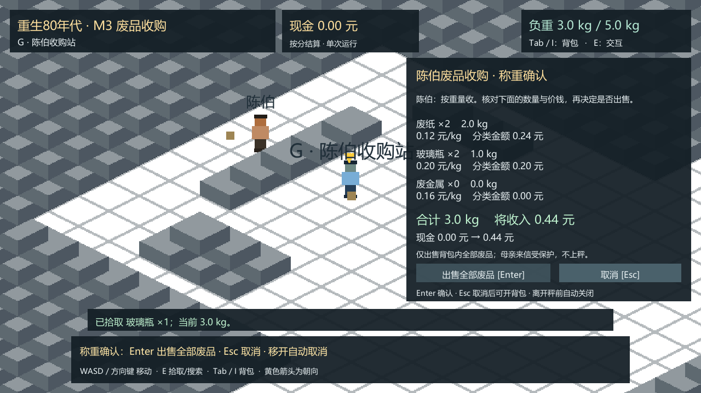
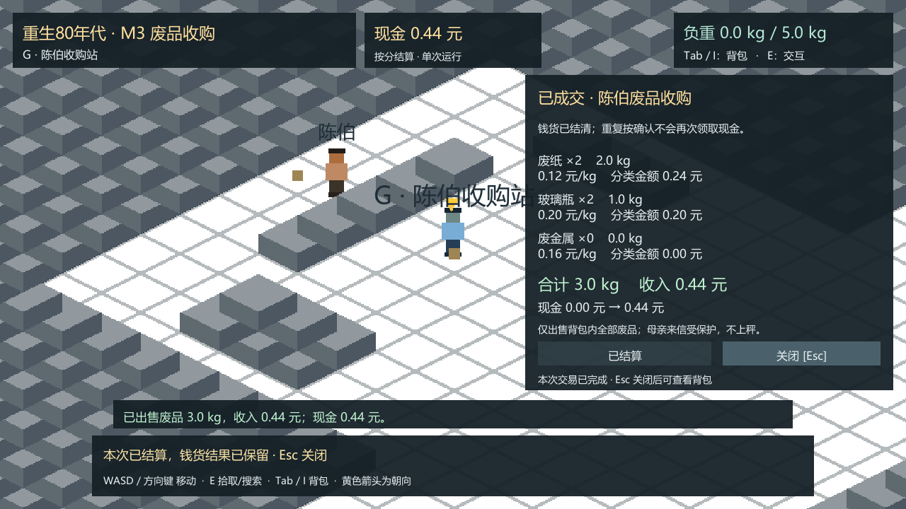

# M3 陈伯废品收购：打开与试玩

> 2026-10-19｜M2审核完成且PR #4已合并；当前M3等待PR审核和负责人Windows实机验收，不进入M4。

本轮依据[P0规格第三幕及第5节](../p0/P0_SPEC.md)、[E-01至E-03验收](../p0/ACCEPTANCE.md#5-交易餐食与旧壶)继续开发，采用规格已允许的“明确一键卖出已知可回收物”方式，没有另设经营需求。沿用 `Unity/Assets/Scenes/M1Greybox.unity`、Unity **6000.3.25f1（e1dba0a9aba4）**、C#、Windows x64、Mono、uGUI及原输入方式。无新依赖，无地图/美术重制。

## 打开与运行

用Unity Hub添加仓库的 `Unity/` 文件夹，使用6000.3.25f1打开 `Assets/Scenes/M1Greybox.unity`，点击Play并聚焦Game视图。已有场景序列化了M3组件，不需要执行地图生成器。陈伯仍是G-03，G-04仍是原秤前站位，门头G-01仅视觉引导；M1的20点位ID/坐标、Tilemap、障碍、玩家和镜头不变。

Windows完整玩家目录为本机 `Unity/Builds/M3-Windows/`，压缩包为 `Unity/Builds/Reborn1985-M3-Windows-x64.zip`。解压并保留全部文件，双击 `Reborn1985.exe`；包内有中文 `试玩说明.txt`。构建二进制由.gitignore排除，没有上传Git。包大小和SHA-256见[构建记录](evidence/build-info.json)。

| 操作 | 键位/方式 |
| --- | --- |
| 移动、朝向 | 原WASD/方向键；交易界面中仍可移动 |
| 拾取、搜索 | 原E键，按下边沿触发，松开后可再按 |
| 背包 | Tab/I开关，1—4选择、X丢弃一件，或鼠标按钮；Esc关闭 |
| 找陈伯询价/称重 | 走到G区柜台前G-04，提示出现后按E |
| 确认出售 | 交易界面按Enter（含小键盘Enter），或点“出售全部废品” |
| 取消/关闭交易 | Esc或对应按钮；未确认时离开站位也会取消 |
| 退出 | 关闭窗口；本轮没有存档，重开会开始新运行且现金归零 |

E只打开交易，重复按E不确认出售。交易窗口与背包不重叠：开交易时关背包，交易中不处理背包快捷键，Esc退出交易后可开背包。近旁若有可拾取废品，E优先保留原拾取功能，取走或挪开后再与陈伯交互。

## 建议试玩流程

先取B-02、D-01的两份纸及D-02、D-03的两只瓶，共3.0kg，再去G柜台前。空手先找陈伯也可查看收购种类和测试价；不需要先读信、做剧情或完成其他NPC交互。

报价逐类显示数量、实际重量、每公斤单价、分类金额、总重量、预计收入与现金前后值。看完可以取消，取消不扣物不发钱。确认后从背包扣除全部可回收废品，并立即增加对应现金、释放负重，显示成交结果。家书不参与选择、称重或出售。

| 正式规格中的测试夹具 | 重量 | 单价 | 本次金额 |
| --- | --- | --- | --- |
| 废纸2份 | 2.0kg | 0.12元/kg | 0.24元 |
| 玻璃瓶2只 | 1.0kg | 0.20元/kg | 0.20元 |
| 基础路线合计 | 3.0kg | 分类称重 | **0.44元（44分）** |
| 废金属1件 | 3.0kg | 0.16元/kg | **0.48元（48分）** |

这些沿用[P0规格5.1](../p0/P0_SPEC.md#51-按重量结算的暂定测试参数)的暂定测试值，不是1985年历史价格或最终平衡。金属可在先卖出基础废品后再取回出售；两笔现金应合计0.92元。林婶餐食与现金消费未在M3实现。

## 实现与防重复保护

现金和累计废品收入用整数分，物品仍用M2整数克；分类金额为“克数×分/kg÷1000”，当前夹具全部精确整分。若日后修改测试参数导致非整分，当前会拒绝成交并提示核对，不自行选择舍入规则。

报价是不可变快照，记录库存修订号、物品身份、分类重量、价格和现金。确认时重新从权威状态计算并核对；背包数量不足、丢弃重拾、报价参数变化都会使旧报价失效，必须重新称重。一次性同步提交扣货、已售身份、现金与成交记录，再通知界面。重复按钮回调、旧报价回放或反复访问没有可再次兑现的待确认交易。

已售身份保留在状态中，来源领取标志不重置；地面物不属于可售背包。M2的家书、超重、搜索次数、丢弃重拾等规则保持。新增快照字段为schemaVersion 2、cashCents、scrapIncomeCents、inventoryRevision、soldUnits与receipts，保留原背包/地面/来源字段，给后续M4接入使用；**本轮没有磁盘保存、恢复、时间或跨日功能**。

可调配置为 `Assets/Settings/M3TradeSettings.asset` 中12/20/16分每公斤及原型交互半径0.8单位。交互在原G-04可走站位接入G-03陈伯，不穿过实体障碍远距触发，也没有把G-04变成另一处奖励来源。没有新增NPC、地图、商品、议价或购买入口。

## 重建与重复验证

菜单 **Reborn 1985 → M3 → Verify trade and M1 M2 regression** 先执行原M1/M2验证，再检查M3交易。输出 `Unity/Logs/M1EditModeValidation.txt`、`M2EditModeValidation.txt`、`M3EditModeValidation.txt`。验证会打开保存场景，请先保存编辑中的修改。

菜单 **Reborn 1985 → M3 → Build Windows x64 development player** 先验证，再重新打开保存场景构建到 `Builds/M3-Windows/`。批处理入口分别为 `Reborn1985.Editor.M3ProjectTools.Verify`、`BuildWindows`。普通打开不用运行Attach工具；该工具只给既有工程附加组件，不生成地图。

开发版加 `-m3-smoke -m3Output "绝对输出目录"` 会运行M3实际玩家测试，输出JSON与6张真实带UI截图。相同构建加原参数 `-m2-smoke -m2Output "绝对输出目录"` 复跑M2全套拾荒与七区路线；两个模式应分别启动，普通启动不自动测试。自动器通过同一刚体、E边沿与UI回调驱动，不声称实体键鼠手工测试；临时三倍模拟速度仅缩短自动行走，不是游戏时间系统。完整结果与限制见[VALIDATION.md](VALIDATION.md)。

## 实际Windows运行截图

其余：[空手询价](screenshots/01-empty-inquiry.png)、[金属48分](screenshots/04-metal-48c.png)、[全部有限资源合计114分](screenshots/05-finite-total-114c.png)、[现金与受保护家书](screenshots/06-cash-and-protected-bag.png)。均为实际WindowsPlayer相机与摄像机Canvas渲染，没有AI或模拟界面。

补查窗口：[1024×768称重界面](screenshots/07-1024x768-confirmation.png)，同一最终Windows构建的36项M3运行检查亦通过。
