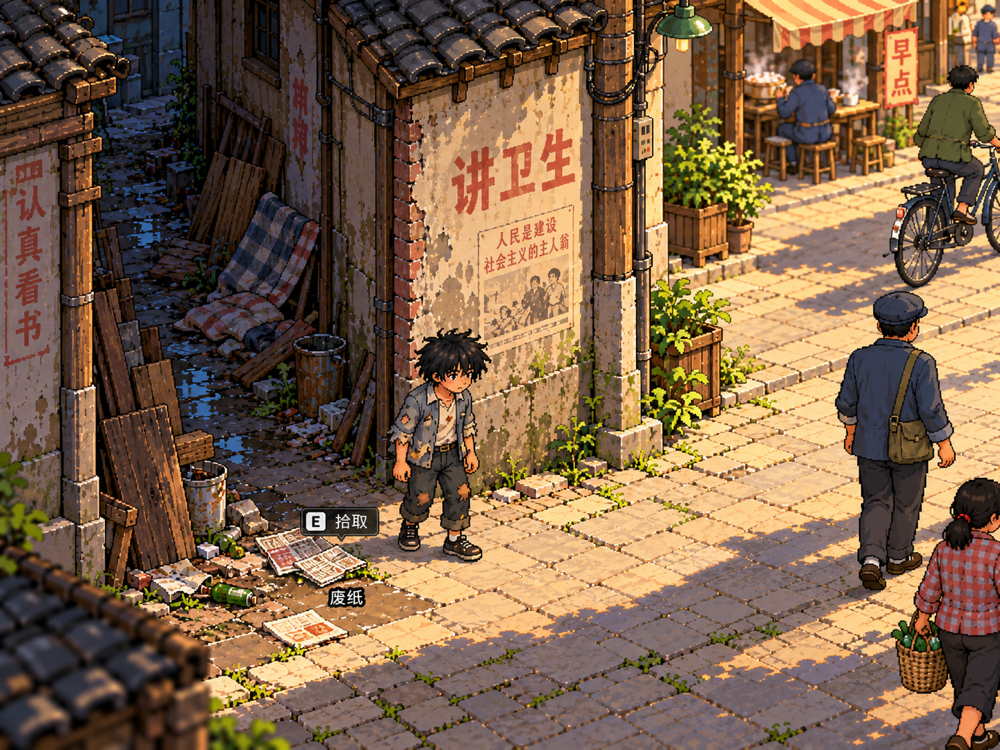
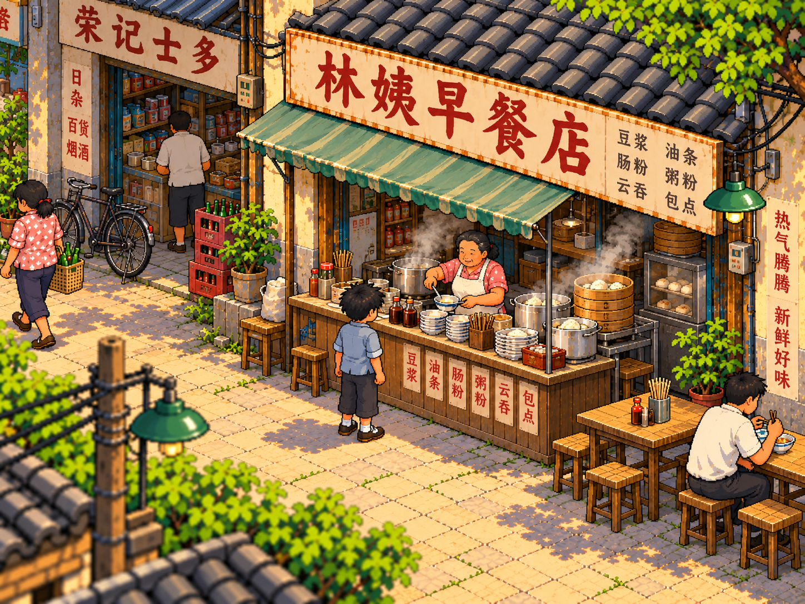
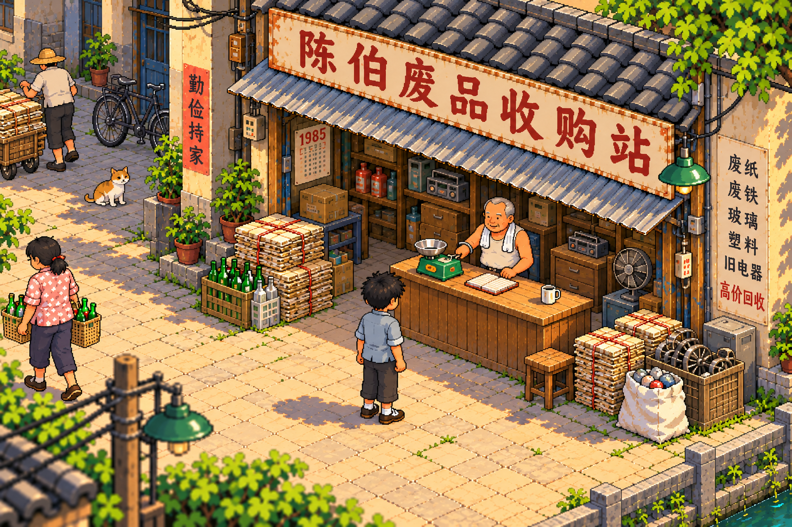

# P0 概念参考图说明

> 阶段：M0｜仅归档五张既有原图｜不是最终贴图、图集、真实运行截图或已确认地图。

[P0规格](../P0_SPEC.md)规定剧情、连通、点位与交互；[决策记录](../REVIEW_AND_DECISIONS.md)记录本轮确认；[图片索引](INDEX.csv)记录原始图片名、ZIP内路径、用途、审核状态、已知问题和SHA-256。

## 1. 使用原则

已确定的方向是接近《大侠立志传》的2D斜俯视像素视觉语言、较近镜头、清晰偏大的角色和暖色清晨县城生活。只借鉴视角、可读性与相对比例，不能复制该游戏素材、贴图或界面。

五张图片来自用户提供的AI概念图交接包，本轮只复制并重命名，字节不变，没有生成、裁切、修图或生产游戏素材。具体生成工具、日期与最终生产使用条件未记载，不声明已完成商用游戏资产验收。

文字规格优先于图中错字、额外物品、店铺数量、UI、日期、价格和建筑位置。不得从图片新增战斗、健康/饥饿/心情系统、市场经营、私人住宅、水道或其他场景需求。图内E键不决定平台和键位，图片像素数不决定游戏逻辑分辨率。

所有场景尚需统一角色、像素密度、投影与可走地图；图中主角衣着破损程度存在漂移。审核状态描述的是参考用途，不是对游戏资产或地图的最终批准。

## 2. 当前五张主参考

| 区域 | 审核状态 | 允许参考 | 已知问题/不得推导 |
| --- | --- | --- | --- |
| A | 暂定氛围参考 | 潮湿破败、旧铺盖、落魄人物与明亮巷口的反差 | 不表现为自家门口；不是统一尺度的实机地图 |
| B | 构图尚未完全通过 | 巷口过渡、首次废纸与较近人物 | 早餐活动露出偏多，需符合走近C才完整展示；镜头、像素细度和E键均未定稿 |
| C | 氛围参考 | 热食蒸汽、邻里与摊位生活 | 图内“林姨”不能替换“林婶”；菜单、价格和桌椅布局不冻结 |
| D | 氛围参考 | 旧商铺、自行车、街道烟火气 | 店前瓶子/纸包可能是私产；店铺数量、布局和水道不成为范围 |
| G | 暂定氛围参考 | 陈伯、秤、柜台和两侧收储 | 交易位与通行仍需验证；陈设不增加回收品类或维修系统 |

### A：破败小巷

### B：巷口与首次拾荒

### C：林婶早餐摊

### D：主街

### G：陈伯收购站

## 3. E/F与历史资料

E旧货角落和F废弃物区尚无通过验收的独立视觉图，依据规格中的E-01/E-02及F-01/F-02/F-03进行后续规划验证，不用其他店铺图替代定稿，不在本轮生成新图。

原交接包仍保留以下资料，本次不整包纳入Git，也不创建指向仓库内不存在文件的链接：

| 原ZIP类别 | 数量/内容 | 状态 |
| --- | --- | --- |
| 03_历史候选图_不可直接实施 | 18张旧街、小巷、收购站与综合看板 | 历史草案，仅对照；旧编号、布局、未批准HUD不覆盖V1.1 |
| 04_早期视觉评审_V0.4 | 11张信息板/切片和Markdown、Word评审文档 | 历史切片参考，不是最新规格；其中采光B为非像素风 |
| Word内嵌图 | 8张，均与外部图片重复 | 不重复归档 |
| 00_五幕场景参考缩略图.jpg | 五主参考的总览 | 查阅预览，不作为额外地图或资产 |
| 原图片索引的省略重复项 | “八五年清晨的老巷弄.png” | 明确省略的重复拷贝，不当作缺图 |

例如历史总览将废金属标为D-03，最新规格中D-03是第二只玻璃瓶，废金属为F-03。部分历史图还有健康/饥饿/心情条、整洁家门口或混合镜头，均不能转为P0需求。

## 4. 后续维护

保留原图来源与校验值；如日后替换参考图，须记录替换原因、审核状态及负责人确认，同步规格链接和索引。归档批准不自动将候选改为最终通过，也不授权生产游戏素材。
